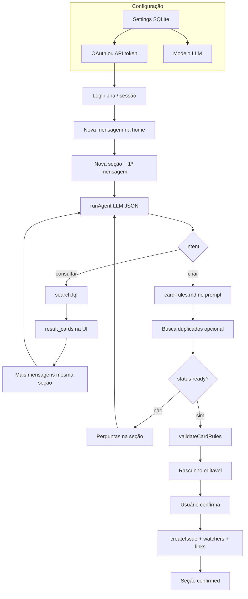

# Holdraft — documentação técnica

Documento em português que descreve o **Holdraft** como está no repositório. Onde algo ainda não foi implementado ou diverge do desenho alvo, a seção [Estado de implementação](#estado-de-implementação) lista os gaps.

---

## O que o app faz

O **Holdraft** é uma aplicação **local** (Next.js) que ajuda a trabalhar com o Jira por meio de um chat:

- Cada **mensagem inicial** abre uma **seção** (thread) persistente no SQLite.
- Um **agente** (LLM com API compatível com OpenAI) classifica a intenção: **consultar** cards existentes ou **preparar criação** de um ou mais cards.
- **Consulta** só lê o Jira (busca JQL); não há confirmação nem gravação.
- **Criação** monta um **rascunho** editável, aplica regras de `agent/card-rules.md`, mostra possíveis duplicados e só grava no Jira após **Confirmar criação no Jira**.
- Não há caixa de e-mail: a entrada é manual (colar ou digitar texto).
- Não há papéis locais: quem entra com a conta Atlassian (OAuth) ou usa API token opera com as **permissões reais** dessa conta no Jira.

---

## Como subir localmente

### Requisitos

- **Node.js 22.15+** (SQLite nativo via `node:sqlite` e flag `--experimental-sqlite` nos scripts npm).
- Conta Jira Cloud e, para OAuth, um app no [Atlassian Developer Console](https://developer.atlassian.com/console/myapps/).
- Provedor de LLM com endpoint **chat/completions** (OpenAI ou compatível).

### Passos

```bash
cd c:\Development\Projects\Personal\2026\jirai
npm install
npm run dev
```

Abra [http://localhost:3000](http://localhost:3000).

1. Em **Configurações** (`/settings`), preencha OAuth Jira (client id/secret), opcionalmente API token + URL do site, e credenciais do modelo.
2. Configure o redirect OAuth no app Atlassian: `{origem}/api/jira/callback` (em dev, tipicamente `http://localhost:3000/api/jira/callback`).
3. Use **Entrar com Jira** e, se quiser, **Testar conexão**.
4. Na página inicial, crie uma **nova seção** com a mensagem inicial e siga o chat.

Build de produção:

```bash
npm run build
npm start
```

---

## Arquitetura

### Stack

| Camada | Tecnologia |
|--------|------------|
| UI | Next.js 15 (App Router), React 19, TypeScript, Tailwind CSS |
| Persistência | `node:sqlite` → arquivo `data/holdraft.db` |
| Chat renderizado | `react-markdown`, `remark-gfm`, `mermaid` (client-side) |
| Jira / LLM | HTTP `fetch` direto (sem SDK oficial) |

Scripts npm prefixam o Next com `node --experimental-sqlite` (`package.json`).

### Estrutura lógica

```
app/
  page.tsx              → Home + HomeChat
  settings/page.tsx     → SettingsForm
  api/
    settings/           → GET/PATCH config (segredos mascarados)
    jira/login|callback|logout|test|assignable
    session/            → sessão pública para a UI
    sections/           → listar, criar seção, detalhe
    sections/[id]/messages/  → continuar chat ou salvar rascunho
    sections/[id]/confirm/   → gravar no Jira

lib/
  db.ts                 → schema SQLite, settings key/value
  settings.ts           → chaves, máscara de segredos
  sections.ts           → CRUD de seções e mensagens
  i18n/                 → catálogos pt-BR e en
  agent/run.ts          → prompt, LLM, enriquecimento Jira
  agent/card-rules.ts   → validação programática (bug + teste)
  agent/types.ts        → tipos do agente e rascunho
  jira/client.ts        → JiraClient + funções auxiliares
  jira/session.ts       → OAuth, cookie, refresh token
  jira/permissions.ts   → parse de mypermissions
  jira/adf.ts           → Markdown → ADF para descrição no Jira

components/
  HomeChat.tsx          → lista de seções, chat, rascunho, confirmar
  MarkdownMessage.tsx   → Markdown + blocos Mermaid

agent/card-rules.md     → regras editáveis (texto para o LLM + doc humana)
```

### Banco SQLite (`lib/db.ts`)

| Tabela | Uso |
|--------|-----|
| `app_settings` | Pares `key` / `value` (OAuth, modelo, idiomas) |
| `sessions` | Conta Atlassian, tokens OAuth, `cloud_id` |
| `sections` | Tipo `consulta` \| `criacao`, título, `draft_json`, status |
| `section_messages` | Histórico user / assistant / system |

### Fluxo de dados (resumo)

1. **POST `/api/sections`** — cria seção, grava mensagem do usuário, chama `runAgent`, persiste `draft_json` e resposta do assistente; ajusta o tipo da seção conforme `intent`.
2. **POST `/api/sections/[id]/messages`** — continua a conversa na mesma seção (tipo fixo) ou atualiza só o rascunho (`{ draft }`).
3. **POST `/api/sections/[id]/confirm`** — valida regras, cria issues, watchers e links no Jira; marca seção `confirmed`.

O agente (`lib/agent/run.ts`) devolve JSON estruturado; a UI e as APIs persistem o estado em `sections.draft_json` (`SectionDraftJson` em `lib/agent/types.ts`).

---

## Login Jira OAuth e permissões

### Configuração OAuth

- **Settings (SQLite):** `jira_oauth_client_id`, `jira_oauth_client_secret`.
- **Redirect:** calculado em runtime — `{origin}/api/jira/callback` (`app/api/jira/login/route.ts`).
- **Escopos** (`lib/jira/session.ts`): `read:jira-work`, `write:jira-work`, `read:jira-user`, `manage:jira-project`, `manage:jira-configuration`, `offline_access`.
- Fluxo: authorize → callback troca `code` por tokens → escolhe recurso Jira em `accessible-resources` → grava/atualiza linha em `sessions` → cookie httpOnly `holdraft_session_id` (30 dias).
- **Refresh:** se `token_expires_at` passou, `getValidSession()` tenta `refresh_token` e atualiza o SQLite.

### API token (alternativa)

Para uma **única conta** sem OAuth: e-mail + token + **URL do site** (`*.atlassian.net`) em settings. Chamadas vão para `{site}/rest/api/3/...` com Basic auth. OAuth na sessão do cookie tem prioridade em `resolveJiraClient()`.

### Permissões Jira

O desenho alvo mapeia ações a permissões via `GET /rest/api/3/mypermissions` (`lib/jira/permissions.ts`):

| Permissão | Uso previsto |
|-----------|----------------|
| `BROWSE_PROJECTS` | Buscar e ler cards |
| `CREATE_ISSUES` | Criar issue / épico |
| `ASSIGN_ISSUES` | Responsável |
| `MANAGE_WATCHERS` | Pessoas adicionais (watchers) |
| `ADMINISTER_PROJECTS` | Criar projeto |
| `ADMINISTER` | Criar grupo |

**Implementado hoje:**

- Classe `JiraClient` expõe `getMyPermissions()` e `testConnection()` (teste usa só `BROWSE_PROJECTS` em `app/api/jira/test/route.ts`).
- Helpers `canBrowseProjects`, `canCreateIssues`, etc. existem, mas **o agente ainda não consulta mypermissions antes de propor ações**; falhas aparecem na resposta da API Jira ou na confirmação.

Chamadas OAuth usam base `https://api.atlassian.com/ex/jira/{cloudId}/rest/api/3/...`. Links de browse usam `jira_site_url` quando configurada.

---

## Consulta vs criação

### Consulta (`sections.type = consulta`)

- Intenção `consultar` forçada se a seção já nasceu como consulta (`runAgent` com `sectionType: "consulta"`).
- Com `status: ready`, o backend executa JQL via `POST .../search/jql` (`searchJql` em `lib/jira/client.ts`, até 15 issues).
- JQL padrão se o modelo não enviar uma: `assignee = currentUser() AND statusCategory != Done ORDER BY updated DESC`.
- Resultados ficam em `draft_json.result_cards`; a UI lista key, resumo, status, prioridade e link.
- **Sem** botão de confirmar e **sem** writes no Jira.
- Uma seção de consulta **não muda** para criação sozinha; novo pedido de abrir card deve ser **nova seção** (comportamento alvo documentado no plano; a UI hoje só cria seção pela caixa “nova seção”).

### Criação (`sections.type = criacao`)

- Intenção `criar` após classificação na primeira mensagem ou seção já criada como criação.
- O prompt inclui o conteúdo de `agent/card-rules.md` (lido do disco a cada rodada de criação).
- Com `search_terms`, busca duplicados (`text ~ "..."`, até 10) → `draft_json.duplicates`.
- Rascunho em `draft_json.draft` (`CreationDraft`: issues, `issue_links`, assignee, watchers no modelo).
- `agent_status === ready` habilita **Confirmar criação** na UI.
- **Confirmar** (`app/api/sections/[id]/confirm/route.ts`):
  1. Revalida `validateCardRules`
  2. Para cada issue com `include_in_confirm !== false`: `createIssue` (descrição via `markdownToAdf`)
  3. Watchers: `POST .../issue/{key}/watchers`
  4. Links: `issue_links` com fallback `Tests` → `Relates`

**Ainda não na rota de confirmação:** criação de projeto, grupo, épico pai/filho (métodos existem em `JiraClient`, mas confirm não os invoca).

---

## Idiomas (UI vs cards)

| Conceito | Onde | Valores |
|----------|------|---------|
| **Idioma da interface** | `ui_language` no SQLite; catálogos `lib/i18n/pt-BR.ts` e `en.ts` | `pt-BR`, `en` |
| **Idioma padrão dos cards** | `card_default_language` | `pt-BR`, `en`, `es` (select em Settings) |

- Textos da UI vêm dos catálogos (`getMessages`, `resolveLocale`); na primeira visita, `Accept-Language` pode escolher `en`.
- O agente recebe no system prompt: idioma da UI para `message_markdown` e idioma dos cards para resumo/descrição.
- Conteúdo colado em outro idioma pode ser entendido pelo modelo, mas o rascunho deve ser escrito no idioma padrão dos cards.
- Chamadas Jira usam identificadores estáveis (`accountId`, nomes de tipo/prioridade conforme o site).

---

## `agent/card-rules.md` e regra bug + teste

### Arquivo

- Caminho fixo: `agent/card-rules.md` (mostrado em Configurações).
- **Consulta** não carrega esse arquivo no prompt.
- **Criação:** `readCardRules()` em `lib/agent/run.ts` injeta o markdown no system prompt; o LLM deve obedecer ao texto completo.

### Regra bug + teste (conteúdo atual)

Todo card de **correção de bug** exige no mesmo rascunho um **card companheiro de teste** para reproduzir o bug:

- Tipo **Test** quando existir no projeto; senão o agente deve perguntar.
- Textos dos dois cards no idioma padrão dos cards.
- Após criar, ligar com `issueLink` — preferência **Tests**, senão **Relates**.
- Não confirmar bug sem o teste completo.

### Validação no código

`lib/agent/card-rules.ts` implementa só parte das regras:

- Detecta issues “bug” (tipo/resumo) e “teste” (tipo Test ou palavras-chave no resumo).
- Se houver bug sem teste suficiente, retorna erro e `runAgent` rebaixa para `need_clarification`; `confirm` também bloqueia.

Outras regras futuras no markdown dependem do LLM até existir validação programática equivalente.

---

## Markdown / Mermaid no chat e ADF no Jira

### Chat (UI)

- `MarkdownMessage` renderiza mensagens com **GFM** (títulos, listas, tabelas, código, links).
- Blocos ` ```mermaid ` viram diagrama via `mermaid.render` no cliente (`securityLevel: "strict"`).
- HTML cru da mensagem não é executado como script; links abrem em nova aba.

### Jira (descrição da issue)

- Na confirmação, `markdownToAdf()` (`lib/jira/adf.ts`) converte descrição do rascunho para **ADF** (parágrafos, headings, listas, code block, negrito, links inline).
- Blocos **Mermaid são removidos** antes da conversão — não entram no corpo do card no Jira.

---

## Onde ficam dados e segredos

| Dado | Local | Git |
|------|--------|-----|
| Banco SQLite | `data/holdraft.db` | Ignorado (`.gitignore` → `data/`) |
| OAuth client secret, API token, model API key | Tabela `app_settings` | Nunca commitar |
| Access/refresh token OAuth | Tabela `sessions` | Nunca commitar |
| Cookie de sessão | `holdraft_session_id` (httpOnly) | Só no browser |
| Regras do agente | `agent/card-rules.md` | Versionado |
| `.env` | Opcional | Ignorado (`.env.*`) |

API **GET/PATCH `/api/settings`** devolve segredos como `***` (`SECRET_KEYS` em `lib/settings.ts`). PATCH ignora valor `***` ou vazio para não apagar segredo existente.

**Boas práticas:** não commitar `data/`, não logar tokens; preferir variáveis de ambiente apenas se o projeto passar a lê-las (hoje o fluxo principal persiste em SQLite via UI).

---

## Diagrama do fluxo



---

## Estado de implementação

Referência honesta em relação ao plano do produto e ao código atual:

| Área | Status |
|------|--------|
| Scaffold Next + Tailwind + SQLite + i18n pt-BR/en | Feito |
| API settings + formulário Settings | Feito |
| OAuth login, logout, refresh, teste conexão | Feito (teste só valida browse amplo) |
| Cliente Jira (busca, criar issue, watchers, links, assignable) | Feito (funções + classe) |
| Agente LLM + seções + UI chat + confirm issues | Feito (fluxo principal) |
| Markdown + Mermaid na UI | Feito |
| ADF na descrição | Feito |
| Regra bug + teste (markdown + validateCardRules + links) | Parcial (validação só bug/teste) |
| mypermissions guiando o agente | **Não** integrado ao `runAgent` |
| Criar projeto / grupo / épico na confirmação | **Não** na rota confirm |
| UI completa para watchers além do assignee | **Parcial** (tipo suporta watchers; editor foca assignee) |
| Sessão OAuth + API token | `resolveJiraClient()` prioriza cookie OAuth; fallback API token em settings |
| `npm run build` | OK (scripts com `--experimental-sqlite`) |
| Verificação E2E no browser (checklist do plano) | Pendente / manual |

---

## Referência rápida de APIs

| Método | Rota | Descrição |
|--------|------|-----------|
| GET/PATCH | `/api/settings` | Config mascarada + resumo da sessão OAuth |
| GET | `/api/jira/login` | Inicia OAuth |
| GET | `/api/jira/callback` | Callback OAuth |
| GET/POST | `/api/jira/logout` | Encerra sessão |
| POST | `/api/jira/test` | Testa Jira + amostra de projetos |
| GET | `/api/jira/assignable?project=&q=` | Usuários atribuíveis |
| GET | `/api/session` | Usuário logado / jiraConnected |
| GET/POST | `/api/sections` | Listar, criar seção |
| GET | `/api/sections?id=` | Detalhe da seção |
| POST | `/api/sections/[id]/messages` | Mensagem ou `{ draft }` |
| POST | `/api/sections/[id]/confirm` | Gravar rascunho no Jira |

---

*Última revisão alinhada ao código do repositório Holdraft (foundation + APIs de seções, agente e OAuth).*
